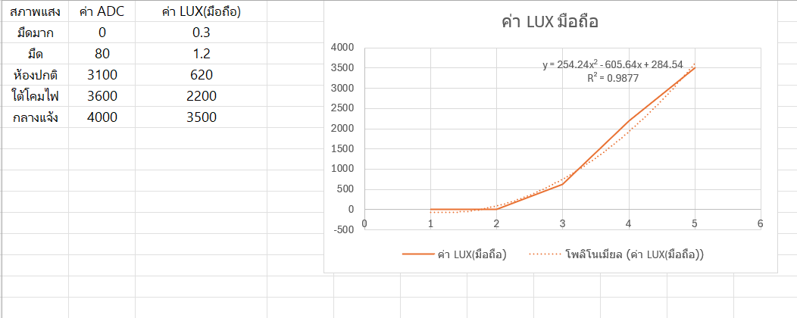

# **ใบงานปฏิบัติการ: การใช้งาน LDR และการทำ Calibration**


## **วัตถุประสงค์ของใบงาน**

1. เข้าใจหลักการทำงานของ LDR (Light Dependent Resistor)
2. ต่อวงจร Voltage Divider เพื่ออ่านค่าแสง
3. อ่านค่า ADC จากบอร์ดไมโครคอนโทรลเลอร์
4. เก็บข้อมูลจริง (ADC vs Lux จากมือถือ)
5. ทำกราฟความสัมพันธ์
6. สร้างสมการ Calibration เพื่อแปลง ADC → Lux
7. ทดสอบความแม่นยำหลัง Calibration

# **ส่วนที่ 1 — ความรู้พื้นฐาน**

## **1.1 LDR คืออะไร**


LDR (Light Dependent Resistor) หรือ Photoresistor คืออุปกรณ์อิเล็กทรอนิกส์ชนิดหนึ่งที่มี **ค่าความต้านทานเปลี่ยนตามความเข้มของแสง** ที่ตกกระทบ

- **แสงมาก → ความต้านทานลดลง**
- **แสงน้อย → ความต้านทานเพิ่มขึ้น**

LDR จึงเหมาะสำหรับงานตรวจจับความสว่าง เช่น ระบบเปิดไฟอัตโนมัติ, ระบบวัดแสง, ระบบควบคุมหน้าจอ, ระบบความปลอดภัย ฯลฯ


## **1.2 โครงสร้างและหลักการทำงานภายใน**

LDR ทำจากสารกึ่งตัวนำ เช่น **Cadmium Sulfide (CdS)** หรือ **Cadmium Selenide (CdSe)**
### เมื่อมีแสงตกกระทบ:
1. โฟตอนของแสงกระตุ้นอิเล็กตรอนในสารกึ่งตัวนำ
2. อิเล็กตรอนหลุดจากแถบวาเลนซ์ไปยังแถบคอนดักชัน
3. จำนวนผู้พาไฟฟ้าเพิ่มขึ้น
4. ความต้านทานลดลง

### เมื่อไม่มีแสง:

- อิเล็กตรอนกลับสู่สภาวะปกติ
- ผู้พาไฟฟ้าลดลง
- ความต้านทานเพิ่มขึ้นมาก (อาจถึงหลายร้อย kΩ)

##  **1.3 พฤติกรรมเชิงคณิตศาสตร์ (Transfer Function)**

ความสัมพันธ์ระหว่าง **ความต้านทานของ LDR (R_LDR)** กับ **ความเข้มแสง (Lux)** ไม่เป็นเส้นตรง แต่เป็นแบบ **Exponential / Power Law**

### **สมการทั่วไปของ LDR**


$$R_{LDR}=A⋅(Lux)^{−α}
$$

โดย
	
	$A$ = ค่าคงที่ขึ้นกับรุ่นของ LDR

	$α$ = ค่าคงที่ (ประมาณ 0.7–0.9)
	
	$Lux$ = ความเข้มแสง

ความหมายคือ:
- เมื่อ Lux เพิ่มขึ้น → R ลดลงแบบโค้ง
- ไม่ใช่ความสัมพันธ์เชิงเส้น

เพื่ออ่านค่า LDR ต้องใช้วงจร **Voltage Divider** เพื่อแปลงความต้านทาน → แรงดัน → ADC อ่านได้

##  **1.4 ทำไมต้องใช้ Voltage Divider**

LDR ให้ “ความต้านทาน” แต่ไมโครคอนโทรลเลอร์อ่าน “แรงดัน” ดังนั้นต้องใช้วงจร **Voltage Divider** เพื่อแปลง R → V

### วงจร Voltage Divider


 **สมการแรงดันที่อ่านได้**


$$V_{out}=V_{cc}⋅\frac{R_{fixed}}{R_{LDR}+R_{fixed}}
$$

เมื่อ:

- $R_{LDR}$ ลดลง (แสงมาก) → $V_{out}$ เพิ่มขึ้น

- $R_{LDR}$ เพิ่มขึ้น (แสงน้อย) → $V_{out}$ ลดลง

## **1.5 ช่วงค่าความต้านทานของ LDR**

ค่าทั่วไปของ LDR

| สภาพแสง  | ความต้านทาน   |
| -------- | ------------- |
| มืดสนิท  | 200 kΩ – 2 MΩ |
| ห้องปกติ | 10 kΩ – 50 kΩ |
| ใต้โคมไฟ | 2 kΩ – 10 kΩ  |
| กลางแจ้ง | 200 Ω – 2 kΩ  |

## **1.6 คำนวณแรงดันเอาต์พุตจากวงจร**

| สภาพแสง  | ความต้านทาน   | แรงดันเอาต์พุต (โวลต์) |
| -------- | ------------- | ---------------------- |
| มืดสนิท  | 200 kΩ – 2 MΩ |                        |
| ห้องปกติ | 10 kΩ – 50 kΩ |                        |
| ใต้โคมไฟ | 2 kΩ – 10 kΩ  |                        |
| กลางแจ้ง | 200 Ω – 2 kΩ  |                        |


---
# **ส่วนที่ 2 — การต่อวงจร**

## **อุปกรณ์ที่ใช้**

- LDR
- R คงที่ 10 kΩ
- บอร์ด ESP32 / Arduino
- สาย Jumper
- แอปวัดแสงในมือถือ (Lux Meter)

## **วงจร Voltage Divider**


**เหตุผลที่ใช้ R 10kΩ:** เป็นค่าที่เหมาะสมสำหรับ LDR ทั่วไป ทำให้แรงดันอยู่ในช่วงที่ ADC อ่านได้ดี

## **ส่วนที่ 3 — การอ่านค่า ADC**

ตัวอย่างโค้ด ESP32 (ADC 12-bit)

```c
#include <stdio.h>
#include "driver/adc.h"
#include "esp_adc_cal.h"
#include "esp_log.h"

#define ADC_CHANNEL     ADC1_CHANNEL_6   // GPIO34
#define ADC_ATTEN       ADC_ATTEN_DB_11  // รองรับ ~3.3V
#define ADC_WIDTH       ADC_WIDTH_BIT_12 // 0–4095

static esp_adc_cal_characteristics_t adc_chars;

void app_main(void)
{
    // 1) ตั้งค่า ADC
    adc1_config_width(ADC_WIDTH);
    adc1_config_channel_atten(ADC_CHANNEL, ADC_ATTEN);

    // 2) ทำ Calibration (ใช้ค่า Vref = 1100mV)
    esp_adc_cal_characterize(
        ADC_UNIT_1,
        ADC_ATTEN,
        ADC_WIDTH,
        1100,              // ค่า Vref ของ ESP32 โดยประมาณ
        &adc_chars
    );

    while (1) {
        // 3) อ่านค่า ADC raw
        int raw = adc1_get_raw(ADC_CHANNEL);
        // 4) แปลงเป็นแรงดัน (mV)
        uint32_t voltage = esp_adc_cal_raw_to_voltage(raw, &adc_chars);
        printf("ADC Raw = %d, Voltage = %d mV\n", raw, voltage);
        vTaskDelay(pdMS_TO_TICKS(500));
    }
}
```

ค่าที่อ่านได้ (12 bit) จะอยู่ในช่วง **0–4095** 

## **ส่วนที่ 4 — การเก็บข้อมูลเพื่อทำ Calibration**

ให้นักศึกษาทำ 5–7 จุดวัด โดยใช้มือถือวัดค่า Lux เทียบกับ LDR โดยเปลี่ยนสภาพแสง ให้มีความแตกต่างกัน

**ตัวอย่างข้อมูล**

| สภาพแสง  | ค่า ADC | ค่า Lux (มือถือ) |
| -------- | ------- | ---------------- |
| มืดมาก   | 0    |      0.3               |
| มืด      | 80    | 1.2             |
| ห้องปกติ | 3100   | 620             |
| ใต้โคมไฟ | 3600    | 2200           |
| กลางแจ้ง | 4000 | 3300             |

**เป้าหมาย:** สร้างกราฟ ADC → Lux เพื่อหาความสัมพันธ์

## **ส่วนที่ 5 — การทำกราฟ เพื่อหาสมการ**

ให้นักศึกษาใช้ Excel / Google Sheet
1. ใส่ข้อมูล ADC และ Lux
2. สร้างกราฟ Scatter
3. ใส่ Trendline
4. เลือก Linear หรือ Polynomial
5. ให้โปรแกรมแสดงสมการ

**ขั้นตอนการหาสมการ**
1. นำข้อมูลป้อนเข้าสู่ excel หรือ google sheet


2. เลือกข้อมูลเพื่อทำกราฟ scatter


3. แทรกกราฟ scatter


4. คลิกขวาที่เส้นกราฟ เลือก เพิ่มเส้นแนวโน้ม


5. ติ๊กที่ตัวเลือก 

	✅ แสดงสมการบนแผนภูมิ 

	✅ แสดงค่า R-squared บนแผนภูมิ

6. เลือกชนิดของกราฟ ที่ทำให้เส้นแนวโน้มทับเส้นข้อมูลมากที่สุด

	สังเกตุจากค่า R-squared ต้องเท่ากับ 1.000 หรือใกล้เคียงมากที่สุด

7. คัดลอกสมการ $y = ...$ ไปใช้ในโปรแกรม


สมมติว่า trend line ได้สมการเป็น $y = 0.42x-50$

แสดงว่ามีความชันของเส้นกราฟเป็น $m=0.42$ และมีจุดตัดแกน $y$  ที่ $b = -50$ ให้เขียน code แบบนี้

```c
Lux = 0.42 × ADC – 50
```

หรือถ้ากราฟไม่เป็นเส้นตรง  ให้ใช้ Polynomial เช่น สมมติว่าได้สมการเป็น $y = 0.0001 × x^2 + 0.3 x – 40$ ให้เขียน code แบบนี้

```c
Lux = 0.0001 × ADC^2 + 0.3 × ADC – 40
```
กราฟที่ได้ 

## **ส่วนที่ 6 — การทำ Calibration ในโค้ด**

ตัวอย่างแบบ Linear Fit

```c
float lux = 0.42 * raw - 50;
```

ตัวอย่างแบบ Polynomial:

```c
float lux = 0.0001 * raw * raw + 0.3 * raw - 40;
```

**หมายเหตุ** 

Code ที่ใช้ สามารถ reuse code  จากการ calibrate ค่ามุมในการทดลองที่แล้วได้


## **ส่วนที่ 7 — การทดสอบผลลัพธ์**

ให้นักศึกษาทดสอบ 3 จุดแสงใหม่ที่ไม่ได้ใช้ตอนเก็บข้อมูล เช่น:

| สภาพแสงใหม่ | ADC  | Lux มือถือ | Lux จากโค้ด |
| ----------- | ---- | ---------- | ----------- |
| ใต้โต๊ะ     | 80 | 1.2        |    0   |
| ห้องเรียน   | 3100 | 620       |     3100    |
| หน้าต่าง    | 4000  | 3500        |    3900    |

ให้นักศึกษาวิเคราะห์ว่า

- ความคลาดเคลื่อนอยู่ในระดับที่ยอมรับได้หรือไม่
- สมการ Linear หรือ Polynomial เหมาะกว่ากัน

## **ส่วนที่ 8 — คำถามท้ายใบงาน**

1. ทำไมต้องใช้ Voltage Divider ในการอ่าน LDR?
--> ตอบ LDR เป็นอุปกรณ์ที่ ค่าความต้านทานเปลี่ยนตามปริมาณแสง แต่ ADC ของ ESP32 ไม่ได้อ่านค่าความต้านทานโดยตรง แต่จะอ่านเป็น แรงดันไฟฟ้า (Voltage) ดังนั้นจึงใช้ Voltage Divider เพื่อเปลี่ยนการเปลี่ยนแปลงของความต้านทาน LDR ให้กลายเป็นแรงดันที่ ADC สามารถอ่านได้
2. ทำไมต้องเก็บข้อมูลหลายจุดก่อนทำ Calibration?
--> ตอบ Calibration คือการปรับค่าที่เซนเซอร์อ่านให้ ใกล้เคียงกับค่าจริง ถ้าเก็บข้อมูลเพียงจุดเดียว เราจะรู้แค่ความสัมพันธ์ในช่วงนั้น แต่ไม่รู้ว่าในระดับแสงอื่น ๆ เซนเซอร์จะมีความคลาดเคลื่อนเท่าไร การเก็บหลายจุด เช่น แสงน้อย --> แสงปานกลาง --> แสงมาก จะช่วยให้เห็นแนวโน้มของเซนเซอร์ และสามารถสร้างสมการสำหรับแปลงค่าได้แม่นยำกว่า
3. ถ้า Noise มากกว่าสัญญาณจริง จะเกิดอะไรขึ้น?
--> ตอบ Noise คือสัญญาณรบกวนที่ไม่ใช่ค่าที่เราต้องการวัด ถ้า Noise มีขนาดมากกว่าสัญญาณจริง ค่าที่ ADC อ่านจะ แกว่งมาก เช่น แสงคงที่แต่ค่าที่อ่านได้เปลี่ยนไปเรื่อย ๆ
ผลคือระบบอาจคิดว่าแสงเปลี่ยน ทั้งที่จริง ๆ แล้วแสงไม่ได้เปลี่ยน ทำให้การคำนวณและการควบคุมอุปกรณ์ ผิดพลาด
4. ทำไมการวางตำแหน่งเซนเซอร์จึงสำคัญต่อ Signal Integrity?
--> ตอบ Signal Integrity หมายถึง คุณภาพและความถูกต้องของสัญญาณ ตำแหน่งของ LDR และการเดินสายมีผลต่อการรับสัญญาณรบกวน เช่น สายที่ยาวเกินไป หรืออยู่ใกล้แหล่งกำเนิดไฟฟ้า/อุปกรณ์ที่มีการสลับสัญญาณ อาจทำให้เกิด Noise ได้ นอกจากนี้ LDR ต้องวางในตำแหน่งที่ได้รับแสงตามที่ต้องการด้วย เพราะถ้ามีเงาบังหรือได้รับแสงจากแหล่งอื่น ค่าที่วัดก็จะไม่ตรงกับสภาพแสงจริง
5. ถ้า ADC มี Resolution ต่ำ จะส่งผลอย่างไรต่อความแม่นยำ?
--> ตอบ ADC ทำหน้าที่เปลี่ยน แรงดันไฟฟ้า → ตัวเลข Resolution คือจำนวนระดับที่ ADC สามารถแบ่งแรงดันออกมาได้ ยิ่ง Resolution สูง ก็ยิ่งแบ่งค่าได้ละเอียด
ตัวอย่าง: 8-bit → 256 ระดับ , 12-bit → 4,096 ระดับ ถ้า Resolution ต่ำ การเปลี่ยนแปลงของแรงดันเล็ก ๆ อาจไม่สามารถแสดงเป็นค่าที่แตกต่างกันได้ ทำให้ค่าที่อ่าน หยาบและมีความละเอียดน้อย

## **ส่วนที่ 9 — ผลลัพธ์ที่คาดหวัง**

ผู้เรียนจะสามารถ:
- ต่อวงจร LDR ได้อย่างถูกต้อง
- อ่านค่า ADC ได้
- เก็บข้อมูลจริงและสร้างกราฟความสัมพันธ์
- ทำ Calibration เพื่อแปลง ADC → Lux
- ประเมินความแม่นยำของระบบวัดแสงที่สร้างขึ้นเอง

## **ส่วนที่ 10 —  Rubric ประเมินตนเอง**

### **ส่วนที่ 10.1 — ความเข้าใจพื้นฐาน LDR (20 คะแนน)**

| ข้อ | รายการ                                                         | คะแนน<br>(0–5 คะแนน) | เหตุผล |
| --- | -------------------------------------------------------------- | -------------------- | ------ |
| 1.1 | อธิบายหลักการทำงานของ LDR ได้ถูกต้อง                           |          4            | เข้าใจว่า LDR มีความต้านทานเปลี่ยนแปลงตามปริมาณแสง โดยเมื่อแสงมากความต้านทานจะลดลง และเมื่อแสงน้อยความต้านทานจะเพิ่มขึ้น แต่ยังอธิบายรายละเอียดเชิงลึกได้ไม่ครบทั้งหมด       |
| 1.2 | อธิบายการทำงานภายใน LDR (โฟตอน → อิเล็กตรอน → conduction band) |       3               | เข้าใจพื้นฐานว่าโฟตอนจากแสงกระตุ้นให้อิเล็กตรอนเกิดการเคลื่อนที่และทำให้การนำไฟฟ้าเพิ่มขึ้น แต่ยังไม่มั่นใจในรายละเอียดเกี่ยวกับ conduction band และกระบวนการภายในวัสดุ       |
| 1.3 | เข้าใจว่าความสัมพันธ์ R vs Lux ไม่เป็นเส้นตรง                  |            4          | เข้าใจว่าความสัมพันธ์ระหว่างค่าความต้านทานของ LDR กับความเข้มแสงไม่ได้เป็นเส้นตรง จึงไม่สามารถใช้สมการเส้นตรงได้ในทุกช่วงของแสง       |
| 1.4 | เข้าใจเหตุผลที่ต้องใช้ Voltage Divider                         |          4            | เข้าใจว่า ADC อ่านค่าเป็นแรงดันไฟฟ้า ไม่สามารถอ่านค่าความต้านทานของ LDR โดยตรง จึงต้องใช้ Voltage Divider เพื่อเปลี่ยนการเปลี่ยนแปลงของความต้านทานให้เป็นแรงดัน      |

### **ส่วนที่ 10.2 — การต่อวงจรและอ่านค่า ADC (20 คะแนน)**

| ข้อ | รายการ                              | คะแนน<br>(0–5 คะแนน) | เหตุผล |
| --- | ----------------------------------- | -------------------- | ------ |
| 2.1 | ต่อวงจร Voltage Divider ได้ถูกต้อง  |           3           | สามารถต่อวงจร Voltage Divider และเชื่อมต่อกับ ADC ได้ แต่ยังต้องตรวจสอบการต่อขาและตำแหน่งของตัวต้านทานก่อนใช้งานเพื่อป้องกันการต่อวงจรผิด        |
| 2.2 | เลือกค่า R คงที่เหมาะสม (เช่น 10kΩ) |           3           | เข้าใจว่าต้องเลือกค่าตัวต้านทานให้เหมาะกับช่วงความต้านทานของ LDR แต่ยังไม่สามารถคำนวณหรือเลือกค่าที่เหมาะสมที่สุดได้ด้วยตนเองทุกกรณี       |
| 2.3 | เขียนโปรแกรมอ่านค่า ADC ได้ถูกต้อง  |            4          | สามารถเขียนโปรแกรมและอ่านค่า ADC จาก ESP32 ได้ถูกต้อง รวมถึงแสดงค่าที่อ่านได้ แต่ยังต้องปรับปรุงเรื่องการจัดการและกรอง Noise ของข้อมูล       |
| 2.4 | ใช้ ESP‑IDF ADC + Calibration ได้   |        4              |  สามารถใช้ ADC ของ ESP-IDF และทำ Calibration เพื่อปรับค่าการอ่านให้เหมาะสมมากขึ้นได้ แต่ยังต้องทำความเข้าใจรายละเอียดของกระบวนการ Calibration เพิ่มเติม      |

### **ส่วนที่ 10.3 — การเก็บข้อมูลจริง (20 คะแนน)**

| ข้อ | รายการ                             | คะแนน<br>(0–5 คะแนน) | เหตุผล |
| --- | ---------------------------------- | -------------------- | ------ |
| 3.1 | เก็บข้อมูล ADC อย่างน้อย 5–7 จุด   |          5            | สามารถเก็บข้อมูล ADC หลายระดับแสงได้ครบตามจำนวนที่กำหนด และนำข้อมูลไปใช้ในการสร้างกราฟและ Calibration       |
| 3.2 | วัดค่า Lux จากมือถือได้ถูกต้อง     |           5           | สามารถใช้มือถือวัดค่า Lux และนำค่าที่ได้มาใช้เป็นค่ามาตรฐานสำหรับเปรียบเทียบกับค่าจาก LDR       |
| 3.3 | จดข้อมูลเป็นตารางครบถ้วน           |        5              | สามารถบันทึกข้อมูล ADC และค่า Lux ของแต่ละจุดได้ครบถ้วน ทำให้สะดวกต่อการนำข้อมูลไปวิเคราะห์        |
| 3.4 | ควบคุมสภาพแสงให้คงที่ระหว่างการวัด |          4            | พยายามควบคุมตำแหน่งและสภาพแสงให้คงที่ แต่ยังมีความคลาดเคลื่อนจากแสงภายนอกและตำแหน่งของเซนเซอร์เล็กน้อย       |


### **ส่วนที่ 10.4 — การทำกราฟและสร้างสมการ Calibration (25 คะแนน)**

| ข้อ | รายการ                                        | คะแนน<br>(0–5 คะแนน) | เหตุผล |
| --- | --------------------------------------------- | -------------------- | ------ |
| 4.1 | สร้างกราฟ Scatter ADC vs Lux ได้              |         5             | สามารถนำข้อมูลที่เก็บได้มาสร้างกราฟ Scatter เพื่อดูความสัมพันธ์ระหว่างค่า ADC กับค่า Lux ได้ถูกต้อง       |
| 4.2 | เลือก Trendline เหมาะสม (Linear / Polynomial) |          4            | สามารถเลือก Trendline ที่เหมาะสมกับลักษณะข้อมูลได้ แต่ยังต้องศึกษาเพิ่มเติมว่าช่วงข้อมูลแบบใดควรใช้ Linear หรือ Polynomial       |
| 4.3 | อ่านสมการจากกราฟได้ถูกต้อง                    |           4           | สามารถอ่านค่าและนำสมการจาก Trendline มาใช้ได้ แต่ยังต้องระวังเรื่องการอ่านค่าตัวแปรและการปัดเศษ        |
| 4.4 | นำสมการไปใช้ในโค้ดได้                         |          5           | สามารถนำสมการ Calibration ที่ได้จากกราฟไปใส่ในโปรแกรม เพื่อคำนวณค่า Lux จากค่า ADC ได้       |
| 4.5 | วิเคราะห์ว่า Linear หรือ Polynomial เหมาะกว่า |           4           | เข้าใจว่าความสัมพันธ์ของ LDR กับแสงไม่เป็นเส้นตรง จึงสามารถพิจารณาใช้ Polynomial ได้ แต่ยังต้องทดลองและเปรียบเทียบค่าความคลาดเคลื่อนเพิ่มเติม       |
### **ส่วนที่ 10.5 — การทดสอบผลลัพธ์และวิเคราะห์ (15 คะแนน)**

| ข้อ | รายการ                                   | คะแนน<br>(0–5 คะแนน) | เหตุผล |
| --- | ---------------------------------------- | -------------------- | ------ |
| 5.1 | ทดสอบจุดแสงใหม่ที่ไม่ได้ใช้ตอนเก็บข้อมูล |           5           | สามารถทดสอบกับระดับแสงใหม่ที่ไม่ได้ใช้ในการสร้างสมการ เพื่อดูว่าสมการ Calibration สามารถนำไปใช้กับข้อมูลใหม่ได้หรือไม่       |
| 5.2 | เปรียบเทียบ Lux มือถือ vs Lux จากโค้ด    |         5             | สามารถนำค่าจากมือถือมาเปรียบเทียบกับค่าที่คำนวณจาก LDR และดูความแตกต่างของผลลัพธ์ได้       |
| 5.3 | วิเคราะห์ความคลาดเคลื่อนและสาเหตุได้     |           4           | สามารถวิเคราะห์ได้ว่าความคลาดเคลื่อนอาจเกิดจาก Noise, ตำแหน่งเซนเซอร์, สภาพแสง, ความแม่นยำของ ADC และความแตกต่างระหว่างเซนเซอร์กับมือถือ แต่ยังวิเคราะห์เชิงลึกได้ไม่ครบทุกปัจจัย     |

###  **คะแนนรวมทั้งหมด:** `84 / 100`

###  **คำถามสะท้อนความเข้าใจ (Reflection)**

ให้นักศึกษาเขียนตอบสั้น ๆ

1. จุดไหนในใบงานที่คิดว่ายากที่สุด?
--> ส่วนที่ยากที่สุดคือการสร้างสมการ Calibration และเลือก Trendline ที่เหมาะสม เพราะต้องเข้าใจความสัมพันธ์ระหว่างค่า ADC กับค่า Lux และต้องวิเคราะห์ว่าควรใช้ Linear หรือ Polynomial เพื่อให้ค่าที่คำนวณได้ใกล้เคียงกับค่าจริงมากที่สุด
    
2. ถ้าทำใบงานนี้อีกครั้ง จะปรับปรุงอะไร?
--> จะปรับปรุงการเก็บข้อมูลให้มีจำนวนจุดมากขึ้น ควบคุมสภาพแสงและตำแหน่งเซนเซอร์ให้คงที่มากขึ้น รวมถึงลด Noise และทดลองเปรียบเทียบสมการหลายรูปแบบเพื่อให้ Calibration มีความแม่นยำมากขึ้น
    
3. ส่วนไหนที่คิดว่าตนเองเข้าใจดีมาก?
--> เข้าใจดีในส่วนของหลักการทำงานของ LDR การใช้ Voltage Divider การอ่านค่า ADC และการนำข้อมูล ADC ไปเปรียบเทียบกับค่า Lux เพื่อสร้าง Calibration และคำนวณค่าความสว่างจากเซนเซอร์

 